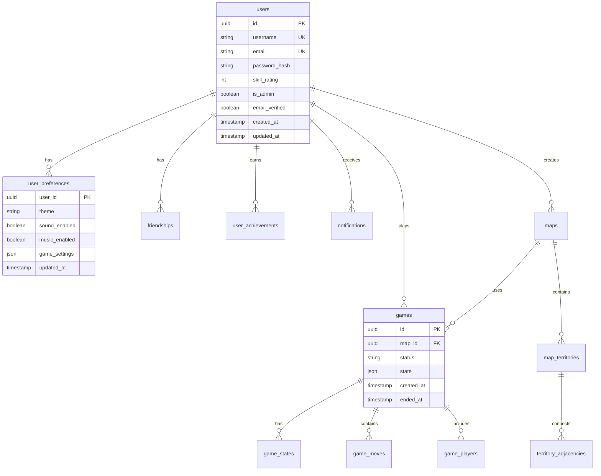

# ConquestK Database Schema Documentation

> **Version**: 1.0.0  
> **Last Updated**: 2025-01-12  
> **Database**: PostgreSQL 14+ (Railway-hosted)  
> **Status**: 🔴 Needs Consolidation

## 📋 Table of Contents
1. [Overview](#overview)
2. [Database Connections](#database-connections)
3. [Schema Diagram](#schema-diagram)
4. [Core Tables](#core-tables)
5. [Consolidation Plan](#consolidation-plan)
6. [Data Dictionary](#data-dictionary)
7. [Relationships](#relationships)
8. [Indexes](#indexes)
9. [Migration History](#migration-history)
10. [Usage Patterns](#usage-patterns)

---

## Overview

The ConquestK database uses PostgreSQL and is hosted on Railway. The schema has evolved organically and currently has redundancy that needs consolidation.

### Key Principles
- **UUID** primary keys for all new tables
- **Soft deletes** where appropriate (deleted_at columns)
- **Audit trails** for admin actions
- **Timestamps** on all tables (created_at, updated_at)

---

## Database Connections

| Environment | Host | Port | Database | SSL |
|------------|------|------|----------|-----|
| **Production** | yamanote.proxy.rlwy.net | 46553 | railway | Required |
| **Staging** | yamanote.proxy.rlwy.net | 59752 | railway | Required |
| **Development** | yamabiko.proxy.rlwy.net | 25470 | railway | Required |

---

## Schema Diagram



---

## Core Tables

### 🔐 Authentication & Users

#### `users` (Core user data)
**Purpose**: Store user authentication and profile information  
**Status**: ✅ Active  
**Used By**: All authentication, profile, and game services

| Column | Type | Default | Nullable | Description |
|--------|------|---------|----------|-------------|
| id | UUID | gen_random_uuid() | NO | Primary key |
| username | VARCHAR(50) | - | NO | Unique username |
| email | VARCHAR(100) | - | NO | Unique email |
| password_hash | VARCHAR(255) | - | NO | Bcrypt hash |
| skill_rating | INTEGER | 1000 | NO | ELO rating |
| is_admin | BOOLEAN | false | NO | Admin flag |
| email_verified | BOOLEAN | false | NO | Email verification status |
| verification_token | VARCHAR(255) | - | YES | Email verification token |
| profile_picture | TEXT | - | YES | Avatar URL |
| bio | TEXT | - | YES | User biography |
| games_played | INTEGER | 0 | NO | Total games |
| games_won | INTEGER | 0 | NO | Win count |
| peak_rating | INTEGER | 1000 | NO | Highest ELO achieved |
| current_tier | VARCHAR(20) | 'bronze' | NO | Skill tier |
| created_at | TIMESTAMP | CURRENT_TIMESTAMP | NO | Account creation |
| updated_at | TIMESTAMP | CURRENT_TIMESTAMP | NO | Last modified |
| deleted_at | TIMESTAMP | - | YES | Soft delete |

**Indexes**: 
- `idx_users_username` (username)
- `idx_users_email` (email)
- `idx_users_skill_rating` (skill_rating DESC)

---

#### `user_preferences` (User settings)
**Purpose**: Store user preferences and settings  
**Status**: ⚠️ Missing columns that code expects  
**Used By**: UserPreferencesService, authController, chatService

| Column | Type | Default | Description | Status |
|--------|------|---------|-------------|--------|
| id | UUID | gen_random_uuid() | Primary key | ✅ Exists |
| user_id | UUID | - | Foreign key to users | ✅ Exists |
| theme | VARCHAR(50) | 'default' | UI theme | ✅ Exists |
| sound_enabled | BOOLEAN | true | Sound effects toggle | ❌ MISSING |
| music_enabled | BOOLEAN | true | Background music toggle | ❌ MISSING |
| notification_enabled | BOOLEAN | true | Push notifications | ❌ MISSING |
| auto_ready | BOOLEAN | false | Auto-ready in games | ❌ MISSING |
| show_timer | BOOLEAN | true | Display turn timer | ❌ MISSING |
| show_army_numbers | BOOLEAN | true | Display troop counts | ❌ MISSING |
| animation_speed | VARCHAR(20) | 'normal' | Animation speed | ❌ MISSING |
| language | VARCHAR(10) | 'en' | Language preference | ❌ MISSING |
| chat_privacy | VARCHAR(20) | 'everyone' | Who can message user | ✅ Exists (unused?) |
| profanity_filter | BOOLEAN | false | Filter profanity | ✅ Exists (unused?) |
| auto_decline_invites | BOOLEAN | false | Auto-decline game invites | ✅ Exists (unused?) |
| game_notifications | BOOLEAN | true | Game event notifications | ✅ Exists |
| created_at | TIMESTAMP | CURRENT_TIMESTAMP | Record creation | ✅ Exists |
| updated_at | TIMESTAMP | CURRENT_TIMESTAMP | Last modified | ✅ Exists |

---

### 🎮 Game Tables

#### `games` (Game instances)
**Purpose**: Store game sessions  
**Status**: ✅ Active  
**Used By**: GameService, gameHandlers

| Column | Type | Description |
|--------|------|-------------|
| id | UUID | Primary key |
| room_id | UUID | Link to game_rooms |
| map_id | UUID | Foreign key to maps |
| status | VARCHAR(20) | waiting/in_progress/completed |
| current_player_id | UUID | Active player |
| turn_count | INTEGER | Turn number |
| phase | VARCHAR(20) | Current game phase |
| winner_id | UUID | Winner's user ID |
| created_at | TIMESTAMP | Game start time |
| ended_at | TIMESTAMP | Game end time |

#### `game_states` (Game state snapshots)
**Purpose**: Store game state for each turn  
**Status**: ✅ Active  
**Used By**: GameService

| Column | Type | Description |
|--------|------|-------------|
| id | UUID | Primary key |
| game_id | UUID | Foreign key to games |
| turn_number | INTEGER | Turn this state represents |
| state | JSONB | Complete game state |
| created_at | TIMESTAMP | State timestamp |

#### `game_moves` (Move history)
**Purpose**: Track all player actions  
**Status**: ✅ Active  
**Used By**: GameService, analytics

| Column | Type | Description |
|--------|------|-------------|
| id | UUID | Primary key |
| game_id | UUID | Foreign key to games |
| player_id | UUID | Player who made move |
| turn_number | INTEGER | Turn number |
| move_type | VARCHAR(50) | Type of action |
| move_data | JSONB | Move details |
| created_at | TIMESTAMP | Move timestamp |

---

### 🗺️ Map Tables

#### `maps` (Map definitions)
**Purpose**: Store map configurations  
**Status**: ✅ Active  
**Used By**: MapService, GameService

| Column | Type | Description |
|--------|------|-------------|
| id | UUID | Primary key |
| name | VARCHAR(100) | Map name |
| description | TEXT | Map description |
| image_url | VARCHAR(500) | Map image URL |
| min_players | INTEGER | Minimum players |
| max_players | INTEGER | Maximum players |
| creator_id | UUID | Map creator |
| is_active | BOOLEAN | Available for play |
| is_public | BOOLEAN | Public visibility |
| status | VARCHAR(20) | draft/published/archived |
| metadata | JSONB | Additional map data |
| created_at | TIMESTAMP | Creation time |
| updated_at | TIMESTAMP | Last modified |

#### `map_territories` (Territory definitions)
**Purpose**: Define territories on maps  
**Status**: ✅ Active  
**Used By**: MapService, GameEngine

| Column | Type | Description |
|--------|------|-------------|
| id | UUID | Primary key |
| map_id | UUID | Foreign key to maps |
| name | VARCHAR(100) | Territory name |
| continent | VARCHAR(100) | Continent grouping |
| polygon | JSONB | SVG path data |
| center_x | INTEGER | X coordinate |
| center_y | INTEGER | Y coordinate |
| bonus_troops | INTEGER | Continent bonus |

#### `territory_adjacencies` (Territory connections)
**Purpose**: Define which territories connect  
**Status**: ✅ Active  
**Used By**: GameEngine (validation)

| Column | Type | Description |
|--------|------|-------------|
| id | UUID | Primary key |
| map_id | UUID | Foreign key to maps |
| territory_from | VARCHAR(100) | Source territory |
| territory_to | VARCHAR(100) | Target territory |

---

### 🔧 Admin Tables

#### `admin_activity_logs` (Audit trail)
**Purpose**: Track all admin actions  
**Status**: ✅ Active  
**Used By**: AdminService

| Column | Type | Description |
|--------|------|-------------|
| id | UUID | Primary key |
| admin_id | UUID | Admin user ID |
| action | VARCHAR(100) | Action performed |
| target_type | VARCHAR(50) | What was affected |
| target_id | VARCHAR(100) | ID of affected item |
| details | JSONB | Action details |
| ip_address | VARCHAR(45) | Admin IP |
| user_agent | TEXT | Browser info |
| created_at | TIMESTAMP | Action timestamp |

---

## 🔄 Consolidation Plan

### Tables to Remove
1. **`user_settings`** → Merge into `user_preferences`
2. **`user_profiles`** → Move useful columns to `users` table
3. **`user_terms_acceptance`** → Add `terms_accepted_at` and `terms_version` to `users`

### Tables to Keep
- ✅ `user_sessions` - Keep for future session management
- ✅ `user_account_status` - Useful for account state tracking
- ✅ All game-related tables
- ✅ All map-related tables
- ✅ All admin tables

### Migration Script (015_consolidate_user_tables.sql)
```sql
-- Step 1: Add missing columns to user_preferences
ALTER TABLE user_preferences 
ADD COLUMN IF NOT EXISTS sound_enabled BOOLEAN DEFAULT true,
ADD COLUMN IF NOT EXISTS music_enabled BOOLEAN DEFAULT true,
ADD COLUMN IF NOT EXISTS notification_enabled BOOLEAN DEFAULT true,
ADD COLUMN IF NOT EXISTS auto_ready BOOLEAN DEFAULT false,
ADD COLUMN IF NOT EXISTS show_timer BOOLEAN DEFAULT true,
ADD COLUMN IF NOT EXISTS show_army_numbers BOOLEAN DEFAULT true,
ADD COLUMN IF NOT EXISTS animation_speed VARCHAR(20) DEFAULT 'normal',
ADD COLUMN IF NOT EXISTS language VARCHAR(10) DEFAULT 'en';

-- Step 2: Migrate data from user_settings to user_preferences
UPDATE user_preferences up
SET 
  theme = COALESCE((SELECT (preferences->>'theme')::VARCHAR FROM user_settings WHERE user_id = up.user_id), up.theme),
  notification_enabled = COALESCE((SELECT (notifications->>'enabled')::BOOLEAN FROM user_settings WHERE user_id = up.user_id), true)
WHERE EXISTS (SELECT 1 FROM user_settings WHERE user_id = up.user_id);

-- Step 3: Add terms columns to users table
ALTER TABLE users
ADD COLUMN IF NOT EXISTS terms_accepted_at TIMESTAMP,
ADD COLUMN IF NOT EXISTS terms_version VARCHAR(20);

-- Step 4: Migrate terms acceptance data
UPDATE users u
SET 
  terms_accepted_at = (SELECT accepted_at FROM user_terms_acceptance WHERE user_id = u.id ORDER BY accepted_at DESC LIMIT 1),
  terms_version = (SELECT version FROM user_terms_acceptance WHERE user_id = u.id ORDER BY accepted_at DESC LIMIT 1)
WHERE EXISTS (SELECT 1 FROM user_terms_acceptance WHERE user_id = u.id);

-- Step 5: Drop unused columns from user_preferences (optional)
-- ALTER TABLE user_preferences 
-- DROP COLUMN IF EXISTS chat_privacy,
-- DROP COLUMN IF EXISTS profanity_filter,
-- DROP COLUMN IF EXISTS auto_decline_invites;

-- Step 6: Drop redundant tables (CAREFUL - ensure data is migrated first!)
-- DROP TABLE IF EXISTS user_settings;
-- DROP TABLE IF EXISTS user_profiles;
-- DROP TABLE IF EXISTS user_terms_acceptance;
```

---

## Usage Patterns

### Common Queries

#### Get user with preferences
```sql
SELECT u.*, up.*
FROM users u
LEFT JOIN user_preferences up ON u.id = up.user_id
WHERE u.id = $1;
```

#### Get game with full state
```sql
SELECT g.*, gs.state, m.name as map_name
FROM games g
JOIN game_states gs ON g.id = gs.game_id
JOIN maps m ON g.map_id = m.id
WHERE g.id = $1
ORDER BY gs.turn_number DESC
LIMIT 1;
```

#### Get user's game history
```sql
SELECT g.*, gp.outcome, gp.final_rating
FROM games g
JOIN game_players gp ON g.id = gp.game_id
WHERE gp.user_id = $1
ORDER BY g.created_at DESC
LIMIT 10;
```

---

## Best Practices

### 1. **Always use transactions** for multi-table operations
```typescript
const client = await pool.connect();
try {
  await client.query('BEGIN');
  // Multiple queries
  await client.query('COMMIT');
} catch (e) {
  await client.query('ROLLBACK');
  throw e;
} finally {
  client.release();
}
```

### 2. **Use prepared statements** to prevent SQL injection
```typescript
await pool.query('SELECT * FROM users WHERE id = $1', [userId]);
```

### 3. **Index foreign keys** for better JOIN performance
```sql
CREATE INDEX idx_games_map_id ON games(map_id);
CREATE INDEX idx_game_states_game_id ON game_states(game_id);
```

### 4. **Use JSONB** for flexible data, not TEXT
```sql
-- Good
metadata JSONB
-- Bad  
metadata TEXT
```

### 5. **Add constraints** to ensure data integrity
```sql
ALTER TABLE games 
ADD CONSTRAINT check_valid_status 
CHECK (status IN ('waiting', 'in_progress', 'completed', 'cancelled'));
```

---

## Migration History

| Number | File | Description | Date | Status |
|--------|------|-------------|------|--------|
| 001 | initial_schema.sql | Initial database setup | 2024-12-01 | ✅ Applied |
| 002 | add_game_tables.sql | Game system tables | 2024-12-15 | ✅ Applied |
| 003 | add_admin_tables.sql | Admin functionality | 2025-01-05 | ✅ Applied |
| 004 | user_preferences.sql | User preferences table | 2025-01-10 | ⚠️ Partial |
| 011 | final_consolidated_schema.sql | Schema consolidation | 2025-01-11 | ✅ Applied |
| 012 | remove_unused_is_verified.sql | Remove duplicate column | 2025-01-11 | ✅ Applied |
| 013 | add_creator_id_to_maps.sql | Add map creator | 2025-01-11 | ✅ Applied |
| 014 | add_map_status_column.sql | Add map status | 2025-01-11 | ✅ Applied |
| 015 | consolidate_user_tables.sql | Fix user table redundancy | 2025-01-12 | 🔄 Pending |

---

## Monitoring & Maintenance

### Check table sizes
```sql
SELECT 
  schemaname,
  tablename,
  pg_size_pretty(pg_total_relation_size(schemaname||'.'||tablename)) AS size
FROM pg_tables
WHERE schemaname = 'public'
ORDER BY pg_total_relation_size(schemaname||'.'||tablename) DESC;
```

### Find slow queries
```sql
SELECT 
  query,
  calls,
  total_time,
  mean_time,
  max_time
FROM pg_stat_statements
WHERE query NOT LIKE '%pg_stat_statements%'
ORDER BY mean_time DESC
LIMIT 10;
```

### Check for missing indexes
```sql
SELECT 
  schemaname,
  tablename,
  attname,
  n_distinct,
  correlation
FROM pg_stats
WHERE schemaname = 'public'
  AND n_distinct > 100
  AND correlation < 0.1
ORDER BY n_distinct DESC;
```

---

## Future Considerations

1. **Partitioning** - Consider partitioning large tables like `game_moves` by date
2. **Read replicas** - Add read replicas for analytics queries
3. **Caching layer** - Add Redis for frequently accessed data
4. **Archive strategy** - Move old games to archive tables
5. **Sharding** - Consider sharding by user_id if scale requires

---

## Contributing

When modifying the database:
1. Always create a migration file
2. Update this documentation
3. Test migrations locally first
4. Never modify production directly
5. Always backup before major changes

---

## Contact

- **Database Admin**: Connor Keetch
- **Last Review**: 2025-01-12
- **Next Review**: 2025-02-01