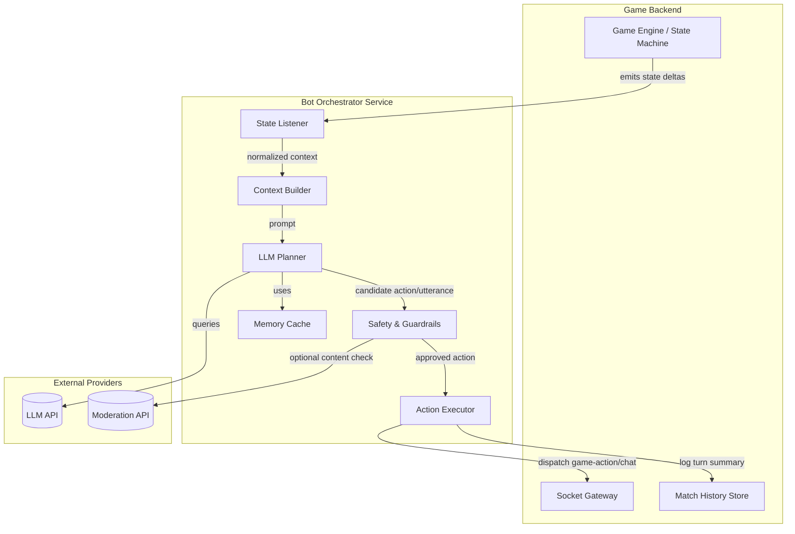

# LLM-Driven Diplomatic Bot: High-Level Implementation Plan

## Purpose & Scope
- Create an LLM-powered non-player agent that can participate in ConquestK matches.
- Support real-time gameplay decisions (deploy, attack, fortify) and social interactions (chat, truces, strategic proposals).
- Deliver a roadmap that spans architecture, data flows, iteration plan, and cost expectations per match.

## Guiding Principles
1. **Human-first experience** – Bot behaviour must feel fair, legible, and optionally toggleable in lobbies.
2. **Safety and compliance** – Keep conversations PG-13, avoid harassment, and respect platform policies.
3. **Observability** – Capture enough telemetry to explain decisions, debug misplays, and audit negotiations.
4. **Modularity** – Keep bot services loosely coupled so different models or heuristics can be swapped without reworking the game loop.

## Target Use Cases
- Fill empty player slots in public or private matches.
- Assist with matchmaking by proposing balanced truces or temporary alliances.
- Act as a practice opponent in single-player or co-op scenarios.
- Provide narrativized commentary for tutorials or special events (stretch goal).

## High-Level Architecture

### Component Responsibilities
- **State Listener**: Subscribes to socket deltas for bot-controlled players, debounces updates, and records turn deadlines.
- **Context Builder**: Transforms raw deltas into structured summaries (board state, risk assessment, trust ledger, negotiation history).
- **LLM Planner**: Crafts prompts, calls the chosen LLM, and interprets tool calls or JSON responses into actionable directives.
- **Action Executor**: Validates moves against rules, sequences multi-step turns, and posts in-match chat messages.
- **Safety & Guardrails**: Enforces content policies, blocks off-topic or unsafe proposals, and rate-limits diplomacy spam.
- **Memory Cache**: Short-term memory of previous turns, commitments, and betrayals to keep negotiations coherent.

## Game Data Needed in Prompts
- Current map ownership, army counts, bonuses, and fortification status per territory.
- Turn order, timers, and outstanding commitments (truces, alliances, betrayals).
- Historical moves (last N turns) to give narrative continuity.
- Player dispositions (trust scores, aggression level) derived from heuristics or prior interactions.
- Match objectives (standard conquest, hidden treasures, custom victory conditions).

## Prompt & Tool Strategy
1. **System prompt**: Defines persona, diplomacy etiquette, and legal move schema.
2. **Game state tool**: Supplies structured JSON with compressed map state.
3. **Action schema**: Require the model to output one of `plan_turn`, `offer_truce`, `respond_truce`, `chat_comment`, or `no_op` with required arguments.
4. **Negotiation tracker**: Provide the model with a memory summary of pending offers and deadlines.
5. **Fallback heuristics**: If the LLM response is invalid or times out, fall back to deterministic heuristics for the turn.

## Iterative Delivery Plan
1. **Phase 0 – Foundations (1-2 weeks)**
   - Define JSON schemas for prompts and tool outputs.
   - Extend socket service to flag bot-controlled players and publish structured deltas.
   - Implement bot orchestrator scaffold with logging, retries, and feature flags.

2. **Phase 1 – Tactical MVP (2-3 weeks)**
   - Support reinforcement and attack decisions using the LLM.
   - Limit diplomacy to reactive responses (accept/decline).
   - Add Jest contract tests for prompt parsing and move validation.
   - Enable opt-in bot matches behind admin-configured toggle.

3. **Phase 2 – Diplomatic Layer (3-4 weeks)**
   - Introduce truce proposal generation and memory tracking.
   - Integrate moderation checks for chat outputs.
   - Add telemetry dashboards (success rate, invalid moves, chat sentiment).

4. **Phase 3 – Polishing (ongoing)**
   - Fine-tune prompts per map type or rule variant.
   - Experiment with hybrid planning (LLM for diplomacy, heuristic combat).
   - Collect feedback from playtests and iterate on tone/strategy knobs.

## Risk & Mitigation
| Risk | Mitigation |
| --- | --- |
| Latency causing missed turns | Parallelize planning per phase; enforce strict response deadlines and fallback heuristics. |
| Unsafe or off-topic chat | Layer moderation API + regex filters; keep trust ledger to detect griefing and disable diplomacy when abused. |
| High per-match cost | Cache state embeddings, reduce prompt size via diff encoding, and allow hosting cheaper distilled models. |
| Model regressions across releases | Version prompts and keep golden transcripts to run regression checks on each upgrade. |
| Gameplay exploits discovered by human players | Log commitments and enforce cooldowns on truce breaches; surface audits to moderators. |

## Cost Assumptions
- Average match length: **35 turns** total (≈7 rounds with 5 participants).
- Bot controls **1 player** but monitors chat from all players.
- Per turn, bot submits **1 planning call** and **0.6 chat calls** on average.
- Prompt/context token budget per planning call: **5,000 input tokens**, **800 output tokens**.
- Chat call budget: **1,500 input tokens**, **400 output tokens**.

### Cost Estimates (USD per match)
| Model | Planning Call Cost | Chat Call Cost | Est. Cost / Match |
| --- | --- | --- | --- |
| OpenAI GPT-4o (8/1 per 1k) | $0.040 per planning call | $0.010 per chat call | ~$1.96 |
| OpenAI GPT-4.1 Mini (1.5/0.6 per 1k) | $0.0075 per planning call | $0.0013 per chat call | ~$0.36 |
| Anthropic Claude 3.5 Sonnet (3/15 per 1k input/output) | $0.015 per planning call | $0.0038 per chat call | ~$0.73 |
| Anthropic Claude 3 Haiku (0.80/4 per 1k) | $0.0040 per planning call | $0.0010 per chat call | ~$0.19 |
| Open-source (self-hosted, e.g., LLaMA 3 70B on GPU cloud @$2/hr) | ~0.5 planning/sec => ~$0.005 per call | ~$0.001 per chat call | ~$0.14 + infra overhead |

> **Notes**
> - Costs assume 35 planning calls and 21 chat calls per match.
> - Prices pulled from public rate cards as of 2025-02; update quarterly.
> - Self-hosted estimate assumes 15-minute match on a single A100 80GB instance at $2/hr amortized.
> - Add ~10% for moderation API usage (e.g., OpenAI or external trust/safety service).

## Monitoring & Telemetry
- **Structured logs**: Trace ID per match, prompt IDs, response latency, fallback usage.
- **Metrics**: Average tokens per call, invalid move rate, acceptance rate of truces, player sentiment scores.
- **Replay tooling**: Store prompts/responses (with redaction) to reconstruct diplomacy transcripts.
- **Alerting**: Trigger when bot misses >2 turns, moderation rejects >5% of messages, or cost spikes >20% week-over-week.

## Future Enhancements
- Fine-tune lightweight models on anonymized match transcripts for cheaper inference.
- Add persona customization (aggressive, cooperative, chaotic) controlled via lobby options.
- Support multi-bot matches with coordination channels for team modes.
- Explore reinforcement learning or search hybrids to improve tactical play while keeping diplomacy LLM-driven.

## Player-Style Clones & Rank Personas

### Feasibility Snapshot
| Scenario | Summary | Effort & Risk |
| --- | --- | --- |
| **Individual "digital twin" of a specific player** | Train a bot to mimic one player's strategic and communication style. | High complexity. Requires the player to opt in, contribute substantial labeled history, and accept privacy/safety review. Biggest risks are overfitting, toxic language copying, and sparse data. |
| **Rank-based personas (10 CP tiers)** | Build bots that approximate aggregate play patterns and tone for each rank. | Moderate complexity. More data available by pooling matches, but still needs careful curation to avoid reinforcing unhealthy meta or leaking private chat content. |

### Option A – Player-Specific Digital Twin
- **Gameplay modelling**: Use behaviour cloning on the player's historical turns (state → action pairs). A sequence model (transformer or large decision transformer) can learn deployment/attack heuristics when given ~5–10k labeled turns (≈50+ full matches) that cover different map/rule variants.
- **Diplomacy modelling**: Fine-tune a mid-size LLM (e.g., GPT-4.1 Mini, Claude 3.5 Sonnet, or an open-source 8–14B model) on the player's chat transcripts. At minimum gather ~200–300 high-quality chat exchanges with metadata (allies, stakes, outcomes). Supplement with synthetic data to teach guardrails and neutral tone resets.
- **Hybrid approach**: Keep the existing orchestration flow but swap in (1) a player-style deployment model and (2) an LLM prompt template seeded with their bio, favourite phrases, and negotiation tendencies. Retrieval-Augmented Generation (RAG) over past chats can reinforce catchphrases without hard-coding them into the base model.
- **Challenges**: Limited data per person, evolving playstyle, and the risk of perpetuating the player's mistakes. Mitigate by blending the player's data with global best practices and letting them review/edit the clone's tone before activation.

### Option B – Rank-Based Personas
- **Data aggregation**: Pool anonymized matches by CP rank. Aim for **200–300 completed matches per rank tier** (≈15k–20k turns) to stabilize statistics. Use telemetry to summarize aggression level, average troop deployments, preferred truces, surrender rates, etc.
- **Modeling tactic**: Train lightweight classifiers/regressors to set aggression knobs, preferred attack thresholds, and diplomacy likelihood. Feed those knobs into the LLM prompt ("You are a Rank 8 bot: prioritize continent control, avoid high-risk gambits, use formal tone.").
- **Communication layer**: Maintain a shared diplomacy LLM, but condition prompts on rank persona descriptors (vocabulary level, risk tolerance, trust defaults). Optionally fine-tune separate adapters/LoRA heads per rank if tone differences are stark.
- **Operational benefit**: Easier to substitute when a player disconnects—pick the bot whose rank matches the slot, inherit alliances/truces from the replaced player, and continue play with familiar pacing.

### Minimum Data Expectations
- **Core telemetry per turn**: Territory ownership, army counts, card state, incoming/outgoing chat, and outcomes of negotiations. Store alongside timestamps and player IDs.
- **Per-player clone**: Target **5k+ turns** (or **50+ matches**) with rich chat history and consent. Less data is feasible but will force heavy use of heuristics and prompt scaffolding instead of true imitation.
- **Per-rank persona**: Target **≥200 matches per rank** to cover map variants and diplomacy styles. If data is scarce, start with combined tiers (e.g., Ranks 1–3, 4–6, 7–10) and split as volume grows.
- **Quality controls**: Redact PII, filter toxic language before training, and label negotiation outcomes (accepted, rejected, betrayed) so the model can link tone to results.

### Delivery Considerations
- **Consent & privacy**: Make opt-in explicit. Offer players visibility into what data powers their clone and a kill switch to disable it.
- **Evaluation loop**: Benchmark clones against historical decisions (top-k action match rate) and run supervised playtests before live deployment.
- **Cost**: Training small adapters/LoRA heads on tens of thousands of turns is affordable (<$500 on rented GPUs). Full fine-tunes on large proprietary models are currently impossible, so plan around open-weight models or prompt-conditioned behaviour with commercial APIs.
- **Fallback**: When data is insufficient, fall back to the general-purpose bot from earlier sections and simply adjust its prompt persona to avoid blocking feature delivery.

